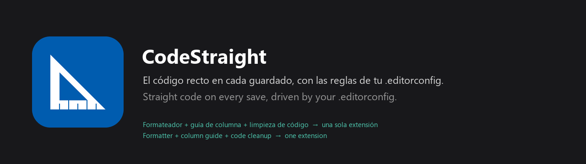

> 🇪🇸 [Español](#español) · 🇬🇧 [English](#english) · 📘 [Manual de uso / User manual](docs/MANUAL.md)

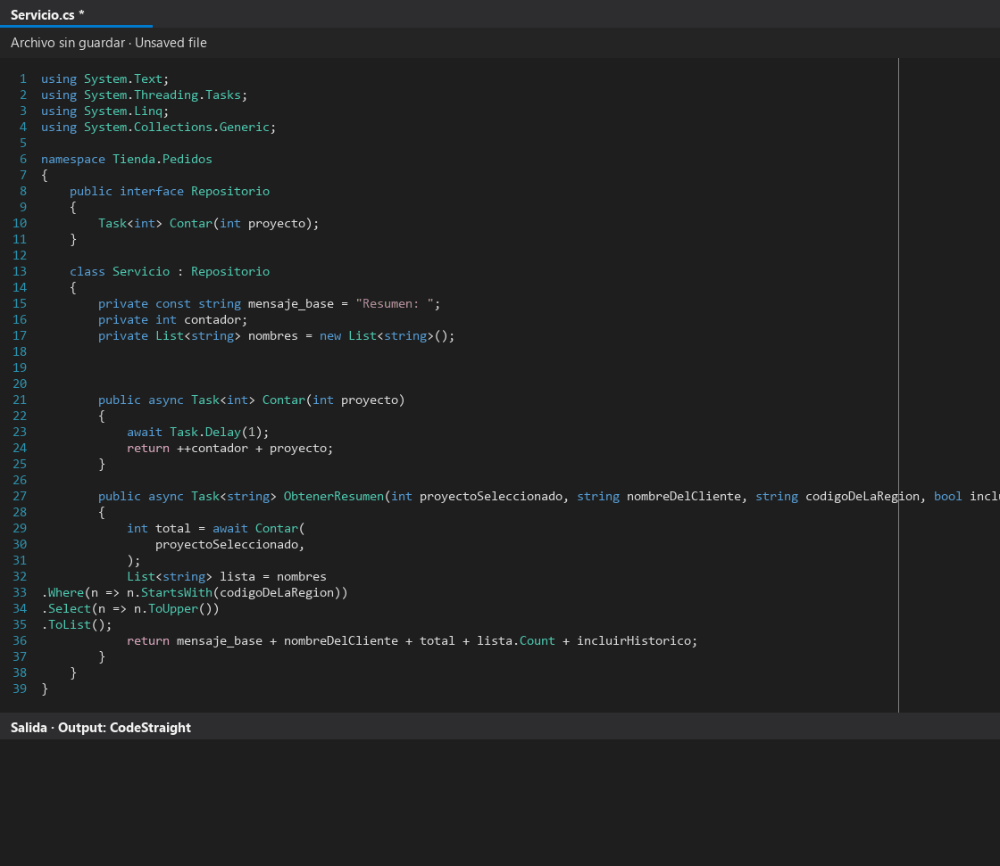

*Un Ctrl+S a cámara lenta; en Visual Studio ocurre todo de una vez. Editor simulado, código y registro reales del motor.*
*One Ctrl+S in slow motion; in Visual Studio it all happens at once. Simulated editor, real engine code and log.*

---

# Español

**CodeStraight** deja el código C# recto **cada vez que guardas**, con las reglas que el equipo ya tiene en el
repositorio. Une en una sola extensión lo que antes necesitaba tres piezas:

| Antes | Con CodeStraight |
|---|---|
| Un formateador (por ejemplo CSharpier) | ✅ incluido |
| Una extensión de guías de columna | ✅ incluido |
| El perfil de *Limpieza de código* de Visual Studio, configurado a mano por cada desarrollador | ✅ incluido |

## Cómo funciona

Todo se configura con **archivos versionados en la raíz del repositorio**, así que todo el equipo obtiene exactamente
el mismo resultado sin tocar las opciones de Visual Studio:

| Archivo | Para qué sirve |
|---|---|
| `.editorconfig` | **Cómo** debe quedar el código: indentación, límite de línea, estilo de namespace, reglas de nomenclatura, codificación… Solo claves estándar, que también entienden Visual Studio y `dotnet format`. |
| `.codestraight` | **Qué** hace CodeStraight: un interruptor por funcionalidad y los pocos valores que solo usa la extensión. |

Al guardar un `.cs`, todas las acciones activas se aplican **en una sola pasada y siempre en el mismo orden**, así que
nunca se pisan entre sí. Si un repositorio no tiene `.codestraight`, la extensión no hace nada en él.

## Funcionalidades

### Renombrado según las reglas de nomenclatura (como Ctrl+R, R)
Renombra la declaración **y todas sus referencias en la solución** (interfaces, implementaciones, llamadas desde otros
archivos) según las reglas `dotnet_naming_*` del `.editorconfig`: `_camelCase` en campos privados, sufijo `Async`,
prefijo `I` en interfaces, constantes en PascalCase, parámetros y variables locales en camelCase, genéricos con
prefijo `T`… El alcance se elige con `rename_scope` (`private`, `internal` o `all`).

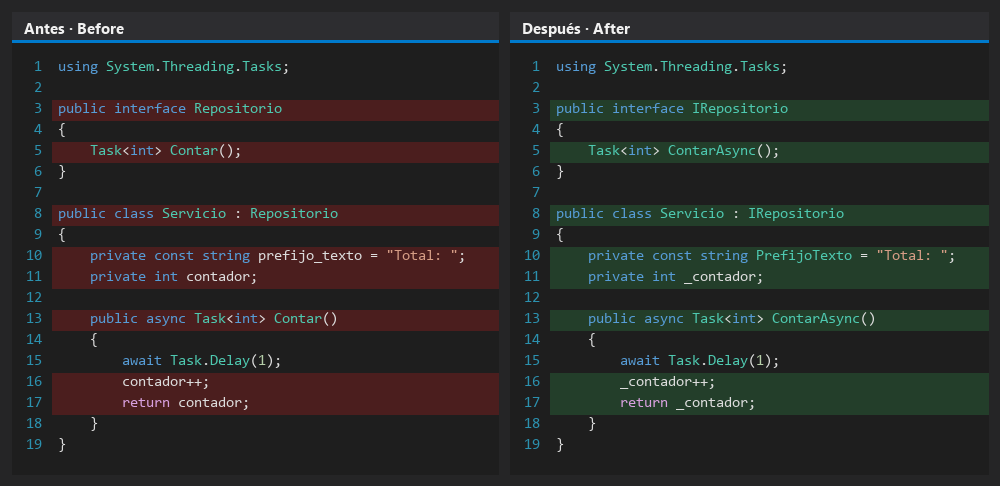

### Namespace de archivo, usings, modificadores y líneas en blanco
Convierte `namespace X { }` en `namespace X;`, quita los `using` que sobran y los ordena (`System` primero), añade los
modificadores de acceso que el compilador ya aplica y elimina las líneas en blanco de más.

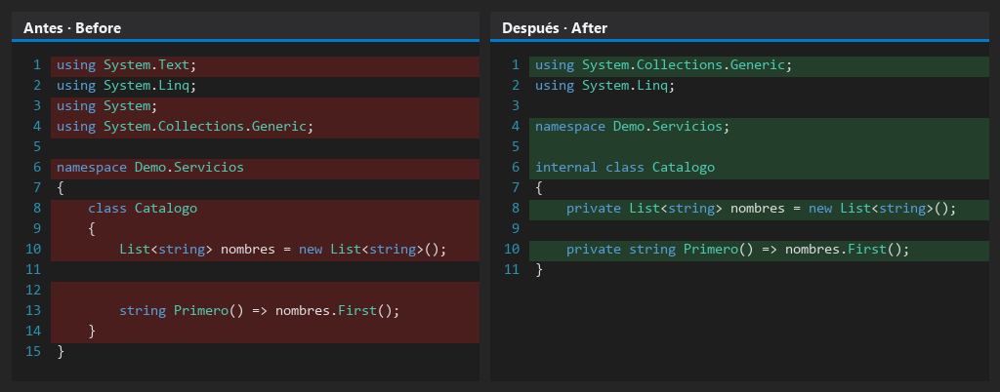

### Indentación de las líneas de continuación
El formateador de Visual Studio no toca las líneas que continúan una expresión (argumentos en su propia línea, cadenas
`.Where().Select()`, colecciones). CodeStraight las coloca un nivel dentro del paréntesis o corchete que las abre.

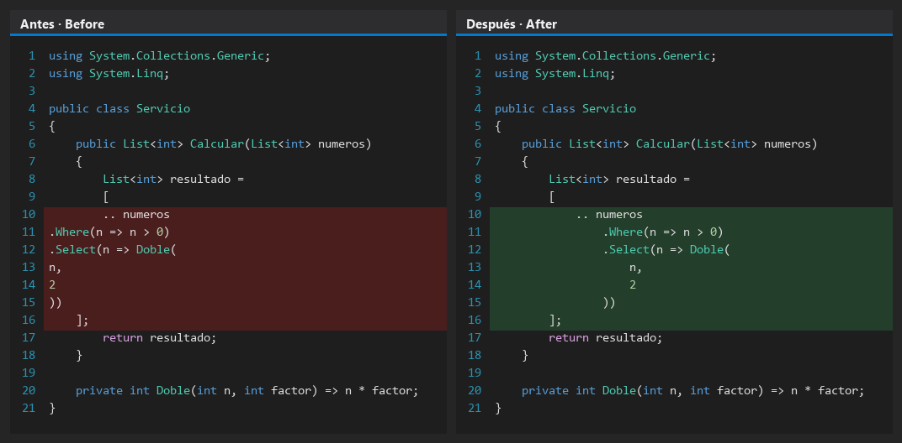

### Partir las líneas largas: uno por línea o compacto
Las líneas que superan `max_line_length` se parten después de la coma, antes de `=>`, en los operadores o en las cadenas
de llamadas. Para parámetros y argumentos hay dos estilos (`wrap_list_style`) y un margen opcional
(`wrap_tolerance`) para las líneas que apenas pasan del límite.

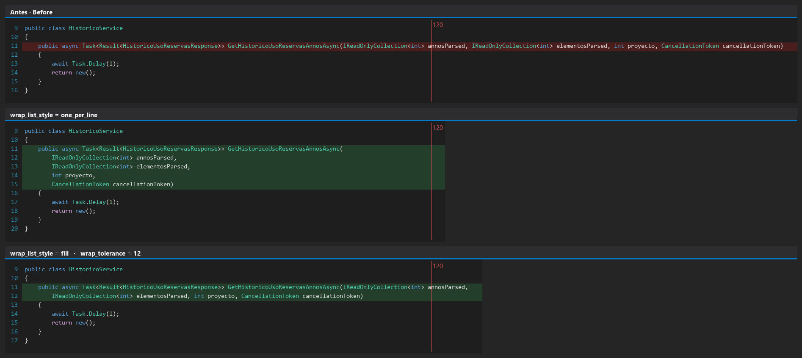

### Textos largos y operadores
Con `split_long_strings`, un texto que no cabe se parte en el último espacio que cabe y se concatena con `+`; el valor no
cambia y sigue siendo una constante (válido en atributos como `[SwaggerResponse]`). Los operadores que quedaron solos en
una línea o en el lado contrario se mueven al lado configurado (`binary_operator_new_line`).

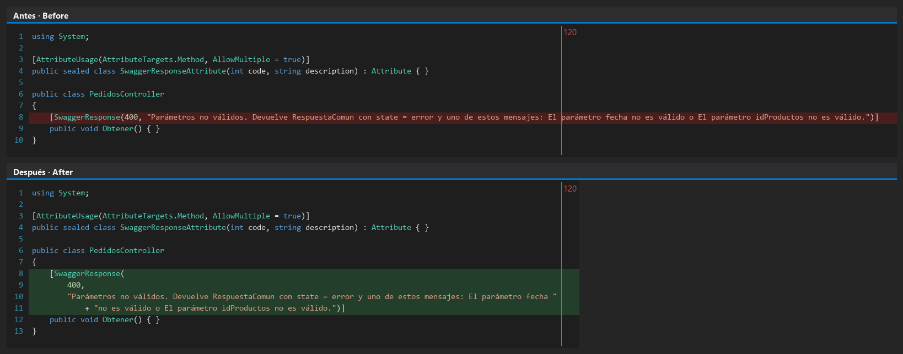

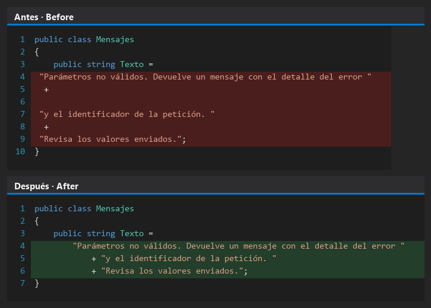

### Coma final
Quita la coma después del último argumento (`Llamar(a, b,)`, que es un error de compilación) y aplica el estilo de coma
final en inicializadores, enums y colecciones (`trailing_comma_style`: `omit`, `include` u `omit_when_single_line`).

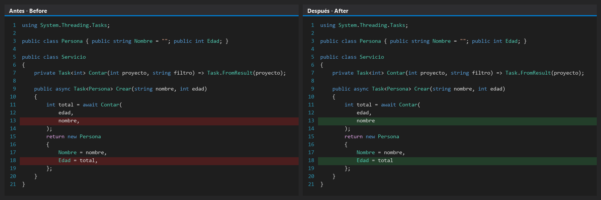

### `var` → tipo explícito (opcional)
Sustituye `var` por el tipo que infiere el compilador, escrito como se escribiría en el archivo (nunca `object`). Los
tipos anónimos mantienen `var`.

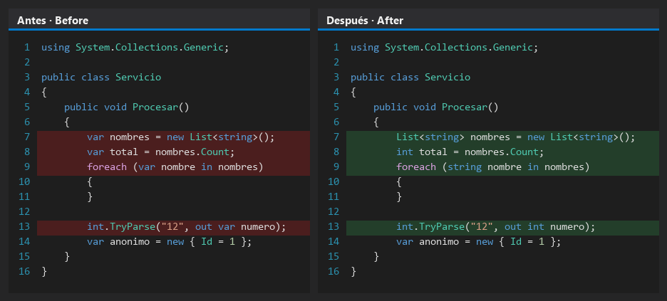

### Codificación y saltos de línea
Guarda cada archivo de texto de la solución (no solo C#) con el `charset` y el `end_of_line` del `.editorconfig`. Un
archivo en Windows-1252 pasa a UTF-8 sin perder ningún carácter (`ñ`, `á`, `¿`, `€`…). Si el archivo se abrió con una
codificación incorrecta y ya muestra `�`, no se convierte y se avisa.

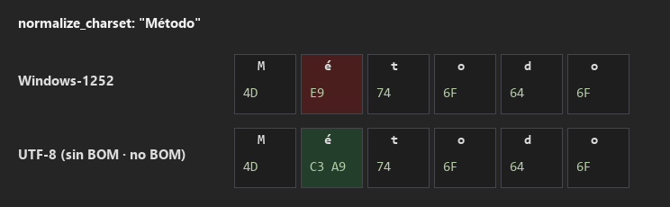

### Guía vertical en el editor
Dibuja una o varias líneas verticales (`guidelines = 80, 120`) con el color que elijas (`guideline_color`).

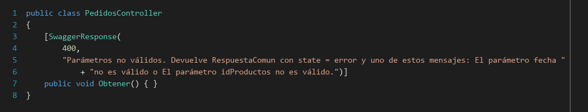

### Todo queda registrado
En **Ver → Salida → CodeStraight** se ve qué acción cambió el archivo, cuál no tenía nada que hacer y, después de
guardar, la codificación con la que quedó realmente en disco.

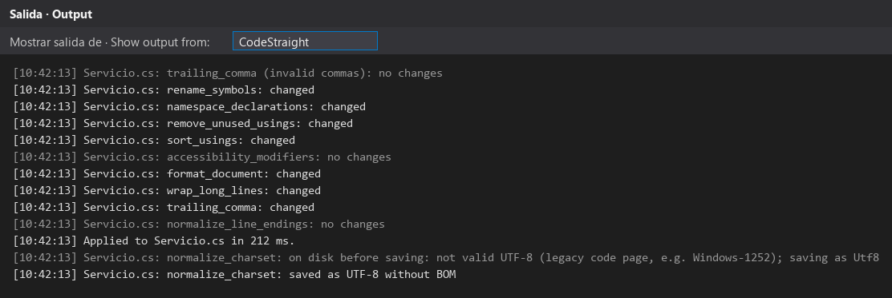

### Y además
- **Indicador en la barra de estado:** verde si CodeStraight está activo en el documento, gris si no, naranja si el último
  guardado tuvo un error. Un clic abre la ventana *Salida*.
- **`remove_comments` (opcional):** quita los comentarios `//` y `/* */`; mantiene los de documentación (`///`).
- **`remove_braces` (opcional):** quita las llaves de `if`/`else`, `for`, `foreach` y `while` con una sola instrucción
  simple, según `csharp_prefer_braces`.
- **`screaming_case_constants` (opcional):** constantes en mayúsculas separadas por `_` (`ValorMaximo` → `VALOR_MAXIMO`),
  con todas sus referencias.

## Seguro por diseño

- **Los archivos generados no se tocan** (`*.g.cs`, `*.Designer.cs`, cabecera `<auto-generated>`).
- **Nunca cambia el comportamiento:** los modificadores añadidos son los que el compilador ya aplica; los textos partidos
  tienen el mismo valor; los usings no usados solo se quitan si el archivo compila.
- **El renombrado no rompe contratos externos:** no renombra lo que sobrescribe o implementa algo de fuera de la
  solución, ni (por defecto) las acciones de los controllers de ASP.NET.
- **Idempotente:** guardar dos veces no produce más cambios.
- **Nunca bloquea el guardado:** si una acción falla, se registra y las demás siguen; si un archivo tarda más de
  10 segundos, se guarda sin cambios.

## Requisitos e instalación

- Visual Studio 2022 (17.8 o posterior) o Visual Studio 2026, en Windows.
- Aún no está publicada en el Marketplace: genera el `.vsix` con `.\build.ps1`, instálalo con doble clic y añade un
  `.codestraight` en la raíz del repositorio. Todos los detalles están en el [manual de uso](docs/MANUAL.md).

## Documentación

| Documento | Contenido |
|---|---|
| [Manual de uso](docs/MANUAL.md) | Instalación, referencia de cada clave, ejemplo completo, limitaciones y solución de problemas. |
| [Historial de versiones](CHANGELOG.md) | Qué cambió en cada versión. |
| `docs/examples` | Configuración de equipo lista para copiar y una demo con todos los problemas juntos. |
| `docs/tools` | Generadores de las imágenes y de la ayuda incluida en la extensión. |

## Desarrollo

```powershell
dotnet test tests/CodeStraight.Core.Tests   # Tests del motor (.NET SDK 10).
.\build.ps1                                 # Tests y .vsix (necesita Visual Studio) en src\CodeStraight.Vsix\bin\Release\net472.
```

| Carpeta | Contenido |
|---|---|
| `src/CodeStraight.Core` | Toda la lógica, sin dependencias de Visual Studio. |
| `src/CodeStraight.Vsix` | Integración con Visual Studio: guardado, guía, barra de estado y ventana *Salida*. |
| `tests/CodeStraight.Core.Tests` | Tests del motor. |

## Licencia

MIT (archivo `LICENSE`).

---

# English

**CodeStraight** keeps C# code straight **every time you save**, with the rules your team already keeps in the
repository. It brings together in one extension what used to take three pieces:

| Before | With CodeStraight |
|---|---|
| A formatter (for example CSharpier) | ✅ included |
| A column guideline extension | ✅ included |
| Visual Studio's *Code Cleanup* profile, configured by hand on every machine | ✅ included |

## How it works

Everything is configured with **files versioned at the root of the repository**, so the whole team gets exactly the
same result without touching Visual Studio's options:

| File | What it is for |
|---|---|
| `.editorconfig` | **How** the code should look: indentation, line length, namespace style, naming rules, encoding… Standard keys only, also understood by Visual Studio and `dotnet format`. |
| `.codestraight` | **What** CodeStraight does: one switch per feature plus the few values only the extension uses. |

When a `.cs` file is saved, every enabled action runs **in a single pass and always in the same order**, so they never
undo each other. In a repository without a `.codestraight` file the extension does nothing.

## Features

### Renaming to your naming rules (like Ctrl+R, R)
Renames the declaration **and every reference in the solution** (interfaces, implementations, callers in other files)
following the `dotnet_naming_*` rules of the `.editorconfig`: `_camelCase` private fields, `Async` suffix, `I` prefix on
interfaces, PascalCase constants, camelCase parameters and locals, `T` prefix on type parameters… Choose how far it
goes with `rename_scope` (`private`, `internal` or `all`).


### File-scoped namespace, usings, modifiers and blank lines
Turns `namespace X { }` into `namespace X;`, removes and sorts usings (`System` first), adds the accessibility modifiers
the compiler already applies and removes surplus blank lines.


### Continuation line indentation
Visual Studio's formatter leaves continuation lines alone (arguments on their own line, `.Where().Select()` chains,
collections). CodeStraight puts them one level inside the bracket that opens them.


### Wrapping long lines: one per line or compact
Lines longer than `max_line_length` are broken after commas, before `=>`, at operators or in call chains. Parameter and
argument lists can use two styles (`wrap_list_style`) and an optional slack (`wrap_tolerance`) for lines that only just
cross the limit.


### Long strings and operators
With `split_long_strings`, a string that does not fit is split at the last space that fits and concatenated with `+`;
the value is the same and it is still a constant (valid in attributes such as `[SwaggerResponse]`). Operators left alone
on a line or on the other side are moved to the configured side (`binary_operator_new_line`).


### Trailing commas
Removes the comma after the last argument (`Call(a, b,)`, a compile error) and applies the trailing comma style of
initializers, enums and collections (`trailing_comma_style`: `omit`, `include` or `omit_when_single_line`).


### `var` → explicit type (optional)
Replaces `var` with the type inferred by the compiler, written as it would be in the file (never `object`). Anonymous
types keep `var`.


### Encoding and line endings
Saves every text file of the solution (not only C#) with the `charset` and `end_of_line` of the `.editorconfig`. A
Windows-1252 file becomes UTF-8 without losing any character (`ñ`, `á`, `¿`, `€`…). If the file was opened with the wrong
encoding and already shows `�`, it is not converted and you are warned.


### Editor guidelines
Draws one or more vertical lines (`guidelines = 80, 120`) in the color you choose (`guideline_color`).


### Everything is logged
**View → Output → CodeStraight** shows which action changed the file, which had nothing to do and, after saving, the
encoding the file really has on disk.


### And also
- **Status bar indicator:** green when CodeStraight is active for the document, gray when it is not, orange when the last
  save had an error. A click opens the *Output* window.
- **`remove_comments` (optional):** removes `//` and `/* */` comments; documentation comments (`///`) stay.
- **`remove_braces` (optional):** removes the braces of `if`/`else`, `for`, `foreach` and `while` with a single simple
  statement, following `csharp_prefer_braces`.
- **`screaming_case_constants` (optional):** upper case constants separated by `_` (`MaxValue` → `MAX_VALUE`), with every
  reference.

## Safe by design

- **Generated files are never touched** (`*.g.cs`, `*.Designer.cs`, `<auto-generated>` header).
- **Behavior never changes:** added modifiers are the ones the compiler already applies; split strings keep the same
  value; unused usings are only removed when the file compiles.
- **Renaming does not break external contracts:** it never renames what overrides or implements something declared
  outside the solution, nor (by default) ASP.NET controller actions.
- **Idempotent:** saving twice produces no further changes.
- **Never blocks a save:** a failing action is logged and the others still run; a file that takes longer than 10 seconds
  is saved unchanged.

## Requirements and installation

- Visual Studio 2022 (17.8 or later) or Visual Studio 2026, on Windows.
- It is not on the Marketplace yet: build the `.vsix` with `.\build.ps1`, double-click it to install and add a
  `.codestraight` file at the root of the repository. Every detail is in the [user manual](docs/MANUAL.md).

## Documentation

| Document | Contents |
|---|---|
| [User manual](docs/MANUAL.md) | Installation, reference of every key, complete example, limitations and troubleshooting. |
| [Release notes](CHANGELOG.md) | What changed in each version. |
| `docs/examples` | A team configuration ready to copy and a demo with every problem at once. |
| `docs/tools` | Generators of the images and of the help shipped inside the extension. |

## Development

```powershell
dotnet test tests/CodeStraight.Core.Tests   # Engine tests (.NET SDK 10).
.\build.ps1                                 # Tests and .vsix (needs Visual Studio) in src\CodeStraight.Vsix\bin\Release\net472.
```

| Folder | Contents |
|---|---|
| `src/CodeStraight.Core` | All the logic, with no Visual Studio dependencies. |
| `src/CodeStraight.Vsix` | Visual Studio integration: saving, guideline, status bar and *Output* window. |
| `tests/CodeStraight.Core.Tests` | Engine tests. |

## License

MIT (`LICENSE` file).
